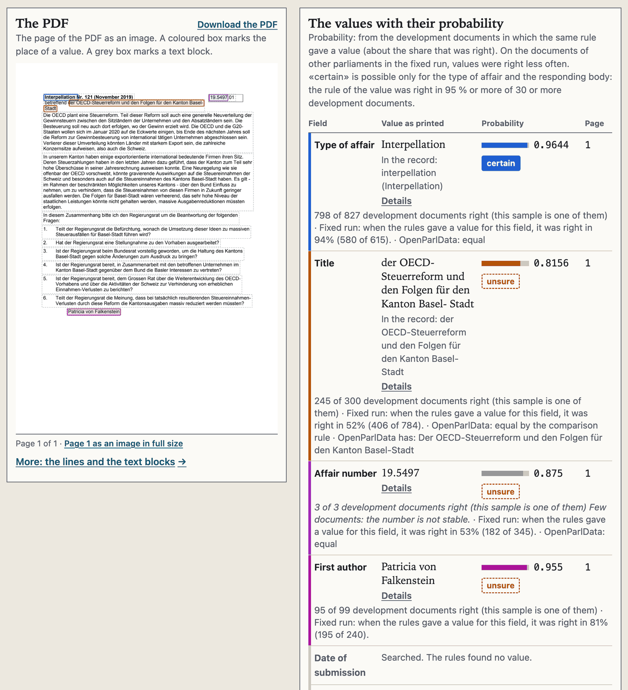
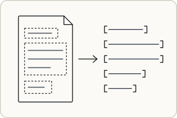
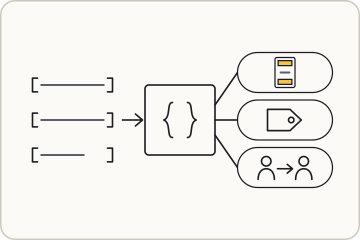
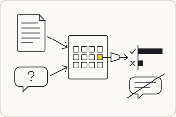
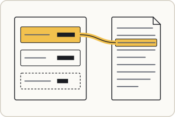

# ParlPDFeCH

A PDF of a Swiss parliament goes in. An eCH-0295 record in RDF comes out.

Code rules read the values from the PDF. Apertus-v1.5-8B reads the whole document on a GPU. Small linear heads on its hidden state then decide 2 values where the rules found none or only a weak one: the affair type and the first author. Each value has a probability, a page and a place in the PDF.

Track 2A (OpenParlData) of the Hack Apertus online hack · [Website](https://parlpdfech.ansv.ch) · [Technical report](track_2a/technical_report.md) · [Value heads on Hugging Face](https://huggingface.co/JonathanKovatsch/parlpdfech-heads)

## Try it

```bash
cd ParlPDFeCH/track_2a
make info                # the state: setup, GPU, results (also: make)
make setup               # one time: packages, PDF reader, Apertus (with a GPU)
make convert PDF=<file>  # or PDF=<URL>, DIR=<folder>, LIST=<file>
make view ID=0001        # the result at http://127.0.0.1:8080/app/
```

You need make, uv, jq, curl and `pdftotext`, and for `make view` also cargo and `wasm-bindgen` 0.2.127. The Apertus step needs a GPU: a Mac with Apple silicon and 32 GB or more, or an NVIDIA GPU with 24 GB or more. The GPU can also be on another computer ([GPU page](track_2a/docs/apertus-gpu.md)). It also needs your own Hugging Face account: `make setup` gives the steps. With no GPU, `make convert` uses the code rules only.

- If `make info` finds no GPU, `make gpu` shows why and the ways to one (a driver, or a GPU of another computer).
- Each PDF gets an ID, and the same PDF keeps its ID. `make list` shows all IDs. A sample: `make convert PDF=app/data/samples/26171/source.pdf`.
- Tested only on one Mac (Apple M4, 32 GB) on 15 and 16.10.2026. Not tested: an NVIDIA GPU, Linux, Windows.
- [All details](track_2a/docs/run-locally.md): the parts of `make setup`, OCR, the terminal table, the Apertus finds below the entry limit, and `make run` (Docker: 3 stored results only, no Apertus).

`make view` shows a result in 3 places: the PDF page with a box on each value, the values with their probability, and the RDF below them. A click on a value marks it in all 3 places.



## How it works

<table>
<tr>
<td width="340"></td>
<td>
<strong>1. The page becomes lines.</strong><br>
Docling finds the text blocks of a PDF page (the dashed boxes).
Code cuts them into lines. Each line keeps its page, its box and its character range (the brackets).
</td>
</tr>
<tr>
<td width="340"></td>
<td>
<strong>2. Code rules decide first.</strong><br>
A rule chain (the braces) reads the lines, from the PDF alone.
It marks the head and foot of each page (the small page) and the role of each block (the tag). It finds a change of author (the 2 persons).
</td>
</tr>
<tr>
<td width="340"></td>
<td>
<strong>3. Apertus decides and writes no text.</strong><br>
Apertus-v1.5-8B (the grid) gets the whole document and one question (the bubble).
A linear head (the funnel) reads its hidden state after layer 20 (the yellow square) and gives a probability for each option (the bars). No text comes out.
Apertus decides only 2 values: the affair type, if the rules found none, and the first author, if the rule value is absent or weak.
<code>make convert</code> runs this step on a GPU.
</td>
</tr>
<tr>
<td width="340"></td>
<td>
<strong>4. Data with its source.</strong><br>
A writer makes the record in Turtle and YAML, and a second RDF file with each value (the card).
Each value has a probability (the bar), a page and a place in the PDF (the yellow marker). For the first author from Apertus, the place is the block that the head picked. For the affair type from Apertus, code finds the first type word of that type; with no such word, the type is not written. A dashed border means unsure.
</td>
</tr>
</table>

## Result

The one fixed run of 13.10.2026 compared 872 documents of 26 parliaments with the OpenParlData register. None of these parliaments was a development parliament. The register is not a hand-checked gold set ([all limits](track_2a/docs/limits.md)). The table gives the share of the documents with a register value that got the register value:

| Field | Code rules only | Code rules and Apertus |
|---|---|---|
| affair type | 0.7923 | **0.8675** |
| first author | 0.4556 | **0.6028** |
| responder | 0.8929 | 0.8929 |
| title | 0.4688 | 0.4688 |
| submission date | 0.2729 | 0.2729 |
| affair number | 0.2214 | 0.2214 |
| response date | 0.2075 | 0.2075 |

Apertus decides only the affair type and the first author. The other fields come from the code rules.

## More

- [Full description for the judges](track_2a/README.md)
- [Run the app: all details](track_2a/docs/run-locally.md)
- [Technical report](track_2a/technical_report.md)
- [Technical report, long version](track_2a/docs/report-long.md)
- [All limits of the result](track_2a/docs/limits.md)
- [All numbers with their sources](track_2a/numbers.json) ([as text](track_2a/numbers.md))
- [Map of the folder track_2a](track_2a/docs/repository-map.md)
- [About: challenge, deliverables, results, eCH-0295, licenses](docs/about.md)

Code: Apache-2.0. Texts: CC-BY-4.0. See `NOTICE`.

Copyright 2026 Jonathan Kovatsch, as a private person.
