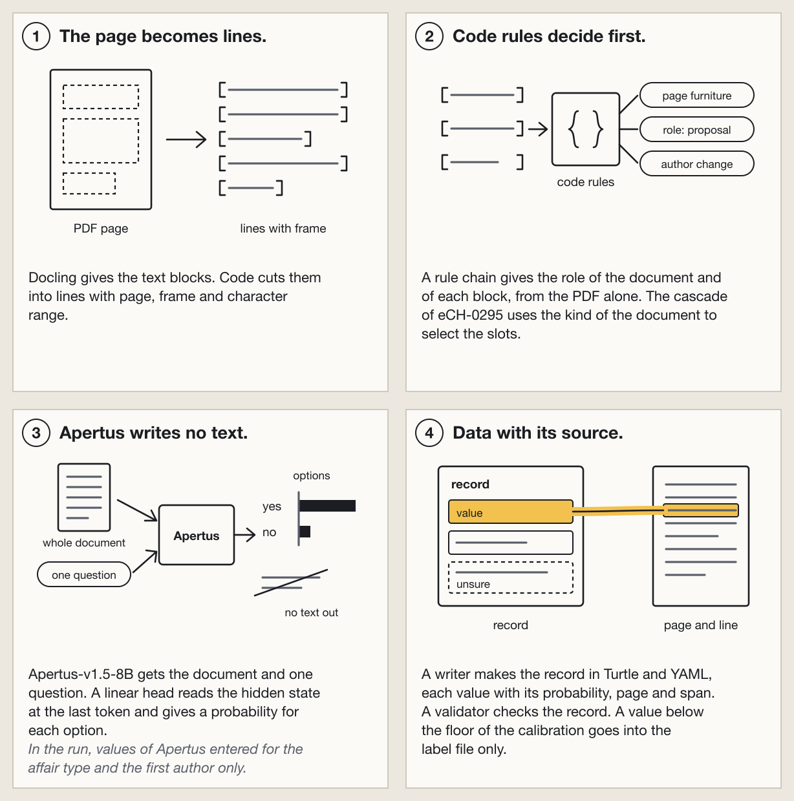

# ParlPDFeCH

A PDF of a Swiss parliament goes in. An eCH-0295 record in RDF comes out.




*The app for one sample: the PDF page with a box for each value, and the values with their probability (output of the app).*

No human checked a value of the run. The reference is the OpenParlData register, not a gold set. [All limits](track_2a/docs/limits.md).

## Try it

In the folder `track_2a/`:

```bash
make setup
make run-native
```

Then open http://127.0.0.1:8080/app/. `make run-native` ran on one Mac. `make run` (Docker) did not run. Details: [run-locally.md](track_2a/docs/run-locally.md).

## More

- [Full description for the judges](track_2a/README.md)
- [Technical report](track_2a/technical_report.md)
- [Technical report, long version](track_2a/docs/report-long.md)
- [All limits of the result](track_2a/docs/limits.md)
- [All numbers with their sources](track_2a/numbers.json) ([as text](track_2a/numbers.md))
- [Map of the repository](track_2a/docs/repository-map.md)
- [About: challenge, deliverables, eCH-0295, licenses, full earlier text](docs/about.md)

Track 2A (OpenParlData) of the Hack Apertus online hack. Code: Apache-2.0. Texts: CC-BY-4.0. See `NOTICE`.

Copyright 2026 Jonathan Kovatsch, as a private person.
