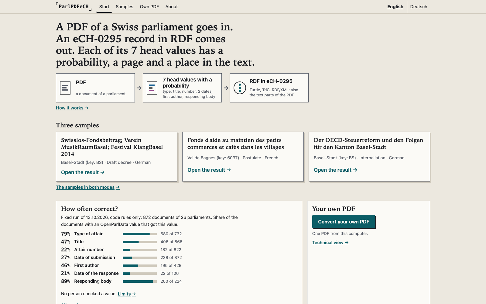

# About ParlPDFeCH

This file holds the full description: challenge, deliverables, eCH-0295, licenses. A path in `code` form starts at the root of the repository. Back to the [front page](../README.md).

The start page of the app (screenshot of 14.10.2026, English).

## Summary

A PDF of a Swiss parliament goes in. An eCH-0295 record comes out. Each of the 7 head values of the record is read from the PDF and has a probability. A value from the rules also has a page and a text span. Identifiers and constants of the record have no probability. The OpenParlData export is the reference of the measurement. No export value goes into a record.

- Author and copyright: see `NOTICE`.
- Challenge: Track 2A (OpenParlData) of the Hack Apertus online hack, "Extracting Parliamentary Affairs from PDFs into One Common Structure". Challenge page: https://hackapertus.notion.site/track-2a-openparldata
- Project folder for the judges: [track_2a/](../track_2a/README.md). It gives the commands, the samples, the method and all results.
- Technical report: [track_2a/technical_report.md](../track_2a/technical_report.md). All limits: [track_2a/docs/limits.md](../track_2a/docs/limits.md).
- State of this text: 14.10.2026. It replaces the text of 12.10.2026.

## Result in short

The one fixed run of 13.10.2026 compared the values of 872 documents of 26 parliaments with the export, one time. The run has 804 validation documents of 18 parliaments and 68 documents of 8 more parliaments (group 7). AI agents had read each group-7 document before the run. Development: 1,793 documents of 44 other parliaments.

Reader with rules only. Reference: the export. No human checked a value of the one fixed run.

| Field | Precision | Found rate | Share correct |
|---|---|---|---|
| affair type | 0.9431 | 0.8402 | 0.7923 |
| title | 0.5179 | 0.9053 | 0.4688 |
| affair number | 0.5275 | 0.4197 | 0.2214 |
| submission date | 0.5289 | 0.5161 | 0.2729 |
| response date | 0.5116 | 0.4057 | 0.2075 |
| responder | 0.9756 | 0.9152 | 0.8929 |
| first author | 0.8125 | 0.5607 | 0.4556 |

- Precision: correct / (correct + wrong). Found rate: (correct + wrong) / documents with a reference. Share correct: correct / documents with a reference.
- Correct means equal to the export value after the normalisation of the project.
- Linear heads on the hidden states of Apertus-v1.5-8B give values for 2 of the 7 fields: where the rules find none, or where the rule value has a probability below 0.5. With them, the share correct is 0.8675 for the affair type and 0.6028 for the first author. A dropped PDF gets values from the rules only.
- No person has accepted these numbers. No pass limit was fixed before the run. Thus this text does not say that a field passes.
- Number ids in [track_2a/numbers.json](../track_2a/numbers.json): `values.last_run.rules_only.all.<field>.precision`, `.found_rate`, `.share_correct`; `values.last_run.combined.all.<field>.share_correct`; `values.last_run.parliaments.<all|validation|group7>`; `values.round4.documents`, `values.round4.parliaments`.

## The 3 strongest limits

1. Fewer than half of the documents with a reference get the export value. This applies to the affair number, the 2 dates, the title and the first author.
2. AI agents had read some of the 872 documents before the run: 116 or more (`values.last_run.contact.read_by_ai_agents.lower_limit`), that is 48 validation documents and all 68 group-7 documents (`values.last_run.contact.kind1.<validation|group7>`). The older rule chain was designed on a list with 38 documents of the run (`values.last_run.contact.rule_design_list.validation`).
3. AI agents of one model family wrote the rules, the tools and the measures, and examined them. No human checked a value of the one fixed run. The reference is a register, not a hand-checked gold set.

[track_2a/docs/limits.md](../track_2a/docs/limits.md) gives all 12 limits of the result with their sources. The technical report adds 3 notes on the method (items 13 to 15 of its chapter 6).

## Deliverables of the challenge

| Deliverable | State on 14.10.2026 |
|---|---|
| 1 Representation model | eCH-0295, working draft I95 (commit `3cab44d`), and the cascade of the project. The project uses eCH-0295 because it is the working draft of the Swiss standard for political affairs. The project gives no mapping to Akoma Ntoso, Parla-CLARIN or Popolo. The cascade uses the kind of the document and the affair type to select the slots that a document can state. File: `track_2a/src/converter_gj/m11_cascade.yaml`. The earlier converter adds the LinkML profile `track_2a/src/converter/m06_ech_profil.yaml` 0.2.0 for its provenance. It changes no eCH-0295 class. |
| 2 Converter: prompts and code | The code of the method of the report: `track_2a/src/converter_gj/`. The prompts for Apertus: `track_2a/src/prompts/gj_values_v1_de/` (value questions) and `track_2a/src/prompts/gj_jev_v1_de/` (block roles). The app: `track_2a/app/`. `make run-native` ran on one Mac. `make run` (Docker) was not run. In the app, the 7 values of a record come from the rules; for the 3 samples, stored Apertus states give the block labels. |
| 3 Evaluation | The one fixed run of 13.10.2026 against the export (see above). The one fixed run has no hand-checked gold set: no human checked a reference value of the export. The author examined 26 records of test documents for the earlier converter. The method of the report was not scored on them. The run has no count by language or by state level. |
| 3 Cross-parliament question | In which parliaments does the PDF with the response of the executive also contain the submitted text? The report gives an answer on development documents (chapter 6). It uses block labels from an Apertus head, compared with AI labels only. The documents are a stratified sample of development parliaments; a share is not the share of all documents of a parliament. It is not a result of the one fixed run. |

The public text of 12.10.2026 (commit `2fd48e2`) described an earlier converter, which takes its metadata values from the export. It is still in `track_2a/src/converter/` (command `make run-earlier`). Its scores on 26 records of test documents are not a part of the one fixed run.

## What is not in this repository, and why

| Item | Reason |
|---|---|
| PDF documents and OpenParlData exports, except the PDF files of the 3 samples | OpenParlData publishes them. The license of the PDF copies is not clear. The app needs the PDF of each sample for its result view: `track_2a/app/data/samples/<doc>/source.pdf`, with the URL of the publisher in `track_2a/app/data/samples/index.json`. |
| Test documents and their records | They are not a part of the one fixed run. The repository gives counts only. |
| Hidden states and fit data of documents other than the 3 samples | They are data of the private project. `track_2a/numbers.json` gives the aggregate values with their source files. |
| Apertus weights, the weights of the value heads, the LoRA adapter | The Apertus use policy has duties for each redistribution. Each user downloads Apertus with an own account. |
| Project notes and the protocol of the private project | They contain internal notes. The README files and the technical report give the facts from them. The work records of the app are in the repository as a part of its source tree: `track_2a/app/STATE.md`, `EXAMINATION.md` and `CONTRACT.md`. They also contain internal notes of the AI agents, for example process numbers and role names. |
| Other copies of eCH-0295 files | The license version of the working draft is not clear. `make setup` downloads the two files from their pinned URLs for the earlier converter. Only `track_2a/app/layout/quellen/` has a copy (chapter "eCH-0295"). |

This repository has its own history. It starts with the publication. It is not the history of the private project.

## eCH-0295

- ParlPDFeCH is an independent project. It is not a product of the association eCH.
- It uses the working draft eCH-0295 of the eCH expert group "Politische Geschäfte": https://github.com/swiss/political-affairs-ech-group, commit `3cab44d` of 30.09.2026.
- eCH-0295 is not approved. ParlPDFeCH does not claim conformity with an approved standard.
- `track_2a/app/layout/quellen/` has the two files below at commit `3cab44d` (same SHA-256), because the app validates each record against them. The licence of the working draft is not clear. The code uses the names of fields and values of eCH-0295. For the earlier converter, `make setup` downloads the two files into `track_2a/.cache/` and examines their SHA-256 (`track_2a/src/fetch_schema.py`).

| File | URL at commit `3cab44d` | SHA-256 |
|---|---|---|
| I95 (`ech-0295_affairs/input/schema.yaml`) | https://raw.githubusercontent.com/swiss/political-affairs-ech-group/3cab44d6a07f60bd8211cccdcf948717ef8fba5c/ech-0295_affairs/input/schema.yaml | `7af4c7a712f16270b653a773179d08cbd1859de053b20fe0beac6b2c2ef30d20` |
| `ech-0292_meta/input/schema_common.yaml` (I95 imports it) | https://raw.githubusercontent.com/swiss/political-affairs-ech-group/3cab44d6a07f60bd8211cccdcf948717ef8fba5c/ech-0292_meta/input/schema_common.yaml | `ab6c097c41cd57c40ad175e9bb130d70f4d4d8eb85281d329bee8c53c8f08b11` |

## License

The file `NOTICE` gives the copyright line, the full table and the attributions.

| Part | License |
|---|---|
| Code: `track_2a/src/`, `track_2a/Makefile` | Apache-2.0 (files `LICENSE` and `LICENSES/Apache-2.0.txt`). Each code file has a line `SPDX-License-Identifier: Apache-2.0`. |
| Prompts for Apertus: `track_2a/src/prompts/` | Apache-2.0. Each prompt text file has the line `SPDX-License-Identifier: Apache-2.0`. A JSON template has no such line, because JSON has no comment lines. The `NOTICE` table applies to it. |
| Documentation: `README.md`, `track_2a/README.md`, `track_2a/SOURCES.md`, `track_2a/technical_report.md`, `track_2a/numbers.md`, `track_2a/docs/`, `NOTICE`, the `README.md` files in `track_2a/src/` | CC-BY-4.0 (file `LICENSES/CC-BY-4.0.txt`) |
| `track_2a/samples/` | Data of OpenParlData under CC BY 4.0 and texts of 3 documents (`track_2a/samples/NOTICE.md`) |
| `track_2a/app/` | Code: Apache-2.0. Texts and derived data files (stored states, head weights, calibration files): CC-BY-4.0, "Source: OpenParlData.ch". `track_2a/app/layout/quellen/`: copies of 2 eCH-0295 files (chapter "eCH-0295"). `NOTICE` gives the rows. |
| `track_2a/data/` | Empty |

- Hack Apertus terms, chapter 6, "What you build is open source": https://hackapertus.ch/terms-and-conditions
- OpenParlData publishes its data under CC BY 4.0 (API description, read on 06.10.2026). Attribution: "Source: OpenParlData.ch". The API description and the project page do not say if this license applies to the PDF copies.
- Apertus is not in this repository. Its license is Apache-2.0, with the Apertus Acceptable Use Policy v1.5: https://huggingface.co/swiss-ai/Apertus-v1.5-8B

Text of the template:

> All Hack Apertus projects are open-sourced. Please check our Terms & Conditions for specific licensing details (6. What you build is open source): https://hackapertus.ch/terms-and-conditions

## About this text

- Language: English, to the rules of ASD-STE100 (Issue 9).
- Authors: AI agents (Claude Opus 5.5) wrote this text for the author on 14.10.2026, from the records of the private project. The private project is the project folder of the author. It is not public.
- No human examined this version of the text.
