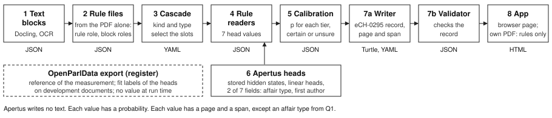

# Technical report — ParlPDFeCH

- **Track:** Track 2A — Extracting Parliamentary Affairs from PDFs into One Common Structure (OpenParlData)
- **Event:** Online
- **Team:** ParlPDFeCH — 1 member (the author)
- **Demo:** no hosted demo. The app runs on your computer (`make run-native`). Repository: <https://github.com/jkovatsch/ParlPDFeCH>, folder `track_2a/`.
- **Version:** 14.10.2026, text version 3. It replaces the earlier text on block labels.
- **Status of each value:** EXCEPTION, NOT RELEASED: no person accepted the plan of the run or these numbers.

A name in square brackets, for example [`sets.docling.all`], is the id of a number in `numbers.json` in the same folder. The end of this report gives the short forms of the ids and the source files.

## 1. Summary

Question: can one method read the head values of a Swiss parliament PDF into an eCH-0295 record, with a probability for each value?

A PDF of a Swiss parliament goes in. An eCH-0295 record comes out. Each of the 7 head values of the record is read from the PDF and has a probability. Each such value also has a page and a text span, except an affair type from an Apertus head. Identifiers and constants of the record have no probability. The OpenParlData export is the reference of the measurement. On development documents it also gives the fit labels of the Apertus heads. At run time no export value goes into a record.

Method. Docling gives the text blocks. Code rules give the role of the document and of each block. The cascade of eCH-0295 selects the slots that a document can state. Rule readers read 7 head values, and a calibration gives each value a probability. A writer makes the record, and a validator checks it. Linear heads on stored hidden states of Apertus-v1.5-8B give values for 2 of the 7 fields (affair type, first author). The other values come from the rules. A dropped PDF gets the rules only.

Result. The one fixed run of 13.10.2026 compared the values of 872 [`R.documents`] documents of 26 [`P.all`] parliaments with the export, one time. With rules only, a share of 0.9431 [`R.affair_type.precision`] of the given affair types is equal to the export value. For the responder this share is 0.9756 [`R.responder_name.precision`]. The share correct is the share of documents with a reference that get the export value. With rules only it is 0.7923 [`R.affair_type.share_correct`] for the affair type and 0.2214 [`R.affair_number.share_correct`] for the affair number. For the affair number, the 2 dates, the title and the first author it is less than 0.5 (table 2).

AI agents wrote the method and examined it, and no human checked a value of the one fixed run. No pass limit was fixed before the run. Chapter 6 gives the limits. No value of this report comes from a test document.

## 2. Architecture

Input: one PDF. Output: one eCH-0295 record in Turtle and YAML, a label file and one validation result. The numbers below are the boxes of figure 1.

1. **Text blocks.** Docling gives blocks with page, frame and text. `ocrmac` reads scanned pages.
2. **Rule files.** A rule chain gives the rule role of the document, for example `proposal`, `response` or `combined`, and the role of each block. In the run, the rule files came from the PDF alone, with empty export fields.
3. **Cascade.** The cascade of eCH-0295 has 5 [`cascade.stages`] stages. The kind of the document (7 [`cascade.kinds`] options) and the affair type select the slots that a document can state. A field outside these slots is not searched. Rule V5 gives a kind where the rule chain gives none. In the run it changed the kind of 46 [`C.kind.v5.changed`] documents.
4. **Rule readers.** Rule readers read 7 head values: affair type, title, affair number, submission date, response date, responder and first author. Each value comes from one rule tier, with its page and its character span.
5. **Calibration.** On 1,793 [`D.documents`] development documents, each pair of field and tier gets a probability: the Jeffreys mean over the folds of a cross-validation. A tier gets the status certain if its precision there is 0.95 [`F.addendum_g.certain_tier_precision`] or more. Each other tier gives the status unsure. A value with a probability below 0.5 [`F.writer_floor`] goes into the label file only, not into a slot.
6. **Apertus heads.** Chapter 3. Two head tiers give a value where the rules find none, or where the rule value has a probability below 0.5. In the run, the first-author tier replaced 6 [`C.tier.apertus_q2_sponsor_hi.replaced_rule_values`] such rule values.
7. **Writer and validator.** The writer makes the record. The label file has the probability, status, page and span of each value. A validator checks the record and its labels.
8. **App.** A browser page shows the records. It gives the 7 values from the rules only. For 3 [`pkg.samples.count`] samples it gives block labels from stored Apertus states. It does not apply the 2 Apertus value tiers of the run. A dropped PDF gets the rules only, with no GPU.

Why rules first: a rule value has a page, a span and a reason that a reader can examine, and it needs no GPU.

## 3. Use of Apertus

- **Model:** `swiss-ai/Apertus-v1.5-8B` (form value `8B v1.5`), bf16, no quantization. The value questions use the unchanged model weights.
- **How it is used:** read-out of hidden states after a forward pass. Apertus generates no token. A linear head reads the hidden state of layer 20 [`F.addendum_i.layer_of_each_head`] at the last token of a question.
- **Where it runs:** a virtual machine with one H100 GPU at Phoeniqs made the states. Then a Mac applied the heads.
- **Part of the result:** values for 2 of the 7 fields. In the run the 2 tiers gave 59 and 79 values with a reference (table 4).

**Prefix and questions.** The prompt is German. The prefix has a system text and the whole document, one line for each block: `[B<n> | S.<page> | <Docling label>] <block text>`. The model reads the prefix one time. Each question then has its own suffix, and after each suffix the cache goes back to the prefix. Thus each question sees the whole document and no other question. The value template `gj_values_v1_de` has the questions `Q0` (kind of the document), `Q1` (affair type) and `Q2` (which head values a block states). Its files are in `track_2a/src/prompts/gj_values_v1_de/`. It uses the prefix of the block-role template in `track_2a/src/prompts/gj_jev_v1_de/`.

**Block roles: measured, not in the run.** Apertus can also give each text block a role, for example submitted text or response text. 2 variants were measured on 44 [`sets.reference.validation.documents`] labelled validation documents, against labels from an AI agent. No certain rule decides 2,325 [`rules.val.non_certain_blocks`] of their blocks. On these blocks, B1-S (a frozen head and a sequence step) gave the AI label for a share of 0.7372 [`val.b1s.acc_noncertain`]. B1-L gave 0.7200 [`val.b1l.acc_noncertain`], and the rules gave 0.4748 [`rules.val.acc_noncertain`]. The 2 variants were the second and third runs on the same 44 documents. B1-S was designed after the result of the first run was known. Thus these values are information, not values of one planned run. The rules saw 42 of the 44 documents during their design. B1-L adds a LoRA adapter to Apertus. The adapter is not published. The readers of the one fixed run used the block roles of the rule chain.

**Value questions.** The entry decisions of the written plan of the run used development documents only:

1. `Q0` (kind) did not enter. On 140 [`H.entry.q0.documents`] documents it gave 106 [`H.entry.q0.head_correct`] correct kinds, as many as the rules [`H.entry.q0.rule_correct`].
2. `Q1` gives the affair type where the rules find none. It entered (table 4). A type from `Q1` has no page and no span.
3. Of `Q2`, only the first author with a high head probability entered (table 4). For the affair number, the title and the submission date, the `Q2` tiers were wrong more often than correct.

**Limits of the use.** Head tier values exist only for documents with stored states. No code reads `LLM_NAME`, `LLM_BASE_URL` and `LLM_API_KEY`: the method needs hidden states. The repository has no Apertus weights.

| Model other than Apertus | Open weights | Role |
|:-------------------------|:----------|:---------------------------------------------------------|
| Docling layout and table models | yes | PDF to blocks. |
| Apple Vision OCR (`ocrmac`) | no | Text of scanned pages. It runs only on macOS. |
| Claude Opus 5.5 (AI agents) | no | Code, rules, the AI labels of the block roles, measurement scripts, audits, the check by eye, this text. |

## 4. Data

- **Source:** the OpenParlData exports of 04.10.2026 and the PDF copies on <https://files.openparldata.ch>. Licence of the data: CC BY 4.0, "Source: OpenParlData.ch".
- **Schema:** eCH-0295, working draft at commit `3cab44d` of <https://github.com/swiss/political-affairs-ech-group> (version I95). It is not a released standard.
- **Split:** by parliament. No parliament of the run is a development parliament.
- **Reference:** the export value of each field after the normalisation of addendum G. For the affair type it is the eCH type that a project map gives for the local type name of the export. No human examined a reference value.
- **Personal data:** the documents hold names of persons with a public role. The repository has the PDF of the 3 samples only, and no text of a validation, group-7 or test document.

Table 1: sets. Tags: `sets.docling.<set>`, `D.parliaments`, `P.<set>`, `sets.test_set.<key>` (protocol only). The run has 26 [`P.all`] parliaments: 18 [`P.validation`] validation parliaments and 8 [`P.group7`] more parliaments (group 7). AI agents had read each group-7 document before the run.

| Set | Documents | Parliaments | Use |
|:-----------|-------:|-------:|:--------------------------------------------|
| development | 1,793 | 44 | design of the value rules, fit of the heads, calibration |
| validation | 804 | 18 | the one fixed run |
| group 7 | 68 | 8 | the one fixed run |
| test set | 40 selected; 26 records | 13 | not used in the one fixed run. The earlier converter of 12.10.2026 was scored on the 26 records. |

Languages of the 2,665 [`sets.docling.all`] documents: German 1,699, French 676, Italian 268, English 1, none 21 [`sets.language.all.<code>`].

## 5. Evaluation

**The one fixed run.** On 13.10.2026 at 21:30, 2 readers gave values for the 872 documents: the reader with rules only and the combined reader. A tool compared each value with the export, one time. The rules, thresholds, heads and entry decisions were fixed before the run. No change after the run is known.

**Reference.** The challenge asks for an evaluation against a hand-checked gold set. The one fixed run has none: its reference is the export, and no human examined a reference value. A separate set has 26 records of test documents (table 1). AI agents proposed them. The author examined each record on the PDF, and a program compared the values that come only from the export with the export record. The acceptance of this reference (step G3a.2) did not take place. The earlier converter of 12.10.2026 was scored on these records. The one fixed run did not use them.

**Measures.** A value is correct if it is equal to the export value after the normalisation of addendum G. Else it is wrong. Precision is correct / (correct + wrong). Found rate is (correct + wrong) / documents with a reference. Share correct is correct / documents with a reference: the product of precision and found rate. Each interval is a 90 % interval of a bootstrap by parliament. The 2 response fields count only documents with the rule role `response` or `combined`. The measure counts each value, also a value below the floor of 0.5 that the writer does not put into the record.

Table 2: reader with rules only. Run: all 872 documents, stem `R` (keys `precision`, `found_rate`, `share_correct`, each interval `.bootstrap_low5` to `.bootstrap_high95`; `correct`, `with_reference`). Development: round 4, 1,793 documents, stem `D` (keys `precision`, `found_rate`, `recall`), mark "after the opening". Reference: the export. No human checked a value. Status EXCEPTION, NOT RELEASED.

| Field | Precision, run (interval) | Found rate, run | Share correct, run (interval) | Correct / with reference, run | Precision, dev. | Found rate, dev. | Share correct, dev. |
|:--------------|:-------------------|-----:|:-------------------|------:|-----:|-----:|-----:|
| affair type | 0.9431 (0.9139 to 0.9660) | 0.8402 | 0.7923 (0.7213 to 0.8581) | 580 / 732 | 0.9580 | 0.8624 | 0.8262 |
| title | 0.5179 (0.4272 to 0.5972) | 0.9053 | 0.4688 (0.3772 to 0.5573) | 406 / 866 | 0.7607 | 0.8984 | 0.6834 |
| affair number | 0.5275 (0.3493 to 0.6890) | 0.4197 | 0.2214 (0.1358 to 0.3207) | 182 / 822 | 0.7591 | 0.4719 | 0.3582 |
| submission date | 0.5289 (0.4003 to 0.6855) | 0.5161 | 0.2729 (0.2027 to 0.3603) | 238 / 872 | 0.6609 | 0.6527 | 0.4314 |
| response date | 0.5116 (0.3673 to 0.7143) | 0.4057 | 0.2075 (0.1119 to 0.3636) | 22 / 106 | 0.8402 | 0.9238 | 0.7762 |
| responder | 0.9756 (0.9272 to 1.0000) | 0.9152 | 0.8929 (0.7974 to 0.9610) | 200 / 224 | 0.9819 | 0.9651 | 0.9476 |
| first author | 0.8125 (0.7454 to 0.8879) | 0.5607 | 0.4556 (0.3690 to 0.5611) | 195 / 428 | 0.8806 | 0.8488 | 0.7474 |

Table 3: combined reader (rules and the 2 Apertus tiers that entered). The other 5 fields are equal to table 2. Run stem `C`, with the keys of table 2; development stem `H.<field>.combined` (keys `precision`, `found_rate`, `share_correct`), mark "after the design values of addendum I". Reference: the export. No human checked a value. Status EXCEPTION, NOT RELEASED.

| Field | Precision, run (interval) | Found rate, run | Share correct, run (interval) | Correct / with reference, run | Precision, dev. | Found rate, dev. | Share correct, dev. |
|:--------------|:-------------------|-----:|:-------------------|------:|-----:|-----:|-----:|
| affair type | 0.9421 (0.9168 to 0.9642) | 0.9208 | 0.8675 (0.8249 to 0.9039) | 635 / 732 | 0.9562 | 0.9228 | 0.8823 |
| first author | 0.8243 (0.7597 to 0.8885) | 0.7313 | 0.6028 (0.5195 to 0.6984) | 258 / 428 | 0.8756 | 0.8634 | 0.7560 |

The 2 tiers raise the found rate of the affair type from 0.8402 [`R.affair_type.found_rate`] to 0.9208 [`C.affair_type.found_rate`]. For the first author it goes from 0.5607 [`R.first_author.found_rate`] to 0.7313 [`C.first_author.found_rate`]. The precision stays near that of the rules.

Table 4: the 2 Apertus tiers. Run stem `C.tier.<tier>` (keys `correct`, `units`, `precision`, `stored_probability`); development stem `H.tier.<tier>` (keys `equal`, `different`, `precision`), the entry data of addendum I. Reference: the export. Status EXCEPTION, NOT RELEASED.

| Tier | Correct / units, run | Precision, run | Equal / different, development | Precision, development | Probability from the calibration |
|:-------------------------|------:|------:|------:|------:|------:|
| `apertus_q1` (affair type) | 55 / 59 | 0.9322 | 93 / 7 | 0.9300 | 0.9257 |
| `apertus_q2_sponsor_hi` (first author) | 67 / 79 | 0.8481 | 15 / 9 | 0.6250 | 0.6200 |

**Values with the status certain.** The status certain exists for 2 fields (table 5). The 5 other fields have 0 certain values [`R.title.certain.values`].

Table 5: values with the status certain, reader with rules only. Run stem `R.<field>.certain` (keys `values`, `correct`, `with_reference`, `precision`); development stem `D.<field>.certain.precision`. Reference: the export. Status EXCEPTION, NOT RELEASED.

| Field | Certain values, run | Correct / with reference, run | Precision, run | Precision, development |
|:----------------|------:|------:|------:|------:|
| affair type | 460 | 426 / 446 | 0.9552 | 0.9699 |
| responder | 175 | 170 / 175 | 0.9714 | 0.9932 |

**Check by eye (information).** 2 AI examiners read the same random sample of 50 [`E.documents`] documents of the run. Each sheet must have the lines of the document and the values of the combined reader, and no export value (plan of the run). Nobody checked the sheets for this rule. An examiner read the first lines, the last lines and the lines near each value, not the full document. The 2 examiners gave a different judgement in 13 [`E.pairs_that_differ`] of 350 [`E.pairs`] pairs of document and field. The check changes no outcome.

Table 6: check by eye. Status EXCEPTION, NOT RELEASED. Stem `E.<a|b>.<field>` (keys `C`, `given`, `M`), mark "reading check"; precision `C.<field>.precision`. "Not given" means: the lines read print the value, and the reader gave none. The 2 columns are different measures on different samples: 50 documents against 872.

| Field | Correct as printed / given: examiner A, B | Not given: A, B | Precision against the export, combined reader, 872 documents |
|:----------------|:--------------|------:|------:|
| affair type | 31, 33 of 40 | 8, 8 | 0.9421 |
| title | 20, 20 of 45 | 3, 3 | 0.5179 |
| affair number | 12, 12 of 15 | 14, 14 | 0.5275 |
| submission date | 18, 18 of 21 | 15, 15 | 0.5289 |
| response date | 3, 3 of 7 | 7, 8 | 0.5116 |
| responder | 17, 17 of 17 | 3, 4 | 0.9756 |
| first author | 25, 25 of 31 | 13, 10 | 0.8243 |

## 6. Limitations

1. With rules only, the share correct is low for the affair number, the submission date and the response date: about 1 of 4 or 5. For the title and the first author it is less than 1 of 2 (table 2). With the combined reader the first author has 0.6028 [`C.first_author.share_correct`].
2. The authors of the value rules of 13.10.2026 read the 44 development parliaments; the 26 parliaments of the run are other parliaments. Addendum I says that these authors opened no file of the 872 documents; no examination compared this statement with the work records. For the title, the affair number and the 2 dates the precision is lower in the run than on the development documents. The found rate also goes down: response date 0.4057 [`R.response_date.found_rate`] against 0.9238 [`D.response_date.found_rate`], first author 0.5607 against 0.8488 [`D.first_author.found_rate`].
3. In the check by eye, each AI examiner named 12 [`E.kind_looks_wrong`] of 50 documents with a kind that looks wrong. For such a document the cascade does not search some fields. The run did not measure the kind.
4. AI agents read 116 [`K.read_by_ai_agents.lower_limit`] or more of the 872 documents in earlier work: 48 [`K.kind1.validation`] validation documents and all 68 [`K.kind1.group7`] group-7 documents. For 300 [`K.s4.all`] of the 872 documents, an audit found a sign of earlier contact: text or values next to the id, or the id in a list of earlier work. For the other 572 [`K.s3.all`] it found no such sign; this is no proof of no contact.
5. The older rule chain makes the rule files of the run. AI agents designed it on a list with 38 [`KD.validation`] documents of the run, of 9 [`KD.validation_parliaments`] of the 18 validation parliaments. For this part the run is not a measure on new parliaments.
6. AI agents of one model family (Claude Opus 5.5) wrote the rules, the tools, the measures and the audits. AI agents of the same family examined them. No human checked a value of the one fixed run, a tool or a number.
7. The reference is a register. A value can be correct as printed and differ from the register. Table 6 compares the check by eye with the precision against the export. For the affair number and the submission date the share correct as printed is more. For the affair type it is less. The cause is not examined.
8. No pass limit was fixed before the run. Thus this report does not say that a field passes. It gives the numbers and their plain meaning.
9. The development values are design values. The authors of the value rules read all 44 development parliaments. These values are optimistic.
10. The reference of the affair type is a project map of the export type. The same value is the fit target of the `Q1` head.
11. Group 7 has 68 documents of 8 parliaments, so its intervals are wide. There the responder has 5 [`G7.responder_name.wrong`] wrong values of 25 [`G7.responder_name.given`], all of 1 parliament. The 21 certain responder values there have a precision of 0.7619 [`G7.responder_name.certain.precision`].
12. Each time comes from one laptop clock, and no outside time stamp exists. Each value has the status EXCEPTION, NOT RELEASED.
Items 13 to 15 are notes on the method. [docs/limits.md](docs/limits.md) gives the 12 limits of the result.

13. The share correct, the comparison in table 6 and table 7 were not planned measures of the plan of the run.
14. A second tool and a third calculation, each by AI agents, gave the same counts of the run from the same files. This does not show that a value is true.
15. On 14.10.2026 a private build pipeline on Linux built a container image from the source tree of the package, which `app/` copies. In that build the converter made the 6 sample records, and each was valid. The image was not started. `make run` ran on one Mac (chapter 7).

Table 7: criterion Breadth, reader with rules only, by set and by parliament. Share correct: stems `V` and `G7` (key `share_correct`). Spread: stem `S.<field>` (keys `parliaments_that_count`, `lowest_precision`, `median_precision`, `highest_precision`), information made after the run. A parliament counts with 5 or more given values with a reference. Status EXCEPTION, NOT RELEASED.

| Field | Share correct, validation (18 parliaments) | Share correct, group 7 (8 parliaments) | Parliaments that count | Precision of a parliament: lowest / median / highest |
|:----------------|------:|------:|------:|:--------------------|
| affair type | 0.8109 | 0.5636 | 21 | 0.4286 / 0.9841 / 1.0000 |
| title | 0.4682 | 0.4769 | 25 | 0.0328 / 0.5714 / 1.0000 |
| affair number | 0.2149 | 0.2941 | 18 | 0.0000 / 0.5228 / 1.0000 |
| submission date | 0.2637 | 0.3824 | 21 | 0.0000 / 0.8000 / 1.0000 |
| response date | 0.1505 | 0.6154 | 2 | 0.2500 / 0.2750 / 0.3000 |
| responder | 0.9091 | 0.7692 | 15 | 0.0000 / 1.0000 / 1.0000 |
| first author | 0.4474 | 0.5088 | 17 | 0.2000 / 0.9091 / 1.0000 |

Breadth: 26 parliaments in the run and 44 in development. Chapter 4 gives the languages of all 2,665 documents, with 268 [`sets.language.all.it`] in Italian. This report has no count of the 872 documents by language or by type of government (federal, canton, municipality). The cascade has 7 kinds of documents, and it searches each head value only for some kinds.

Table 8: criterion Insight, the head values against eCH-0295. Tags: `cascade.<key>` (read), `gaps.affair_type.all` (protocol only), `sets.docling.all`, table 7. Status EXCEPTION, NOT RELEASED.

| Question | Answer |
|:------------------------------|:---------------------------------------------------------------|
| Does eCH-0295 say which slots a document can state? | The working draft states no condition by affair type. The cascade has 53 rules: 24 come from eCH-0295, 7 come from other files of the project, and 22 are choices of the cascade with no rule in the standard. |
| How many slots can one document state? | The kind of the document selects 18 to 61 of 87 slots. 12 slots only a register can give. |
| Which head values can one reader take from PDFs of many parliaments? | For 6 of the 7 fields the precision differs much between parliaments (table 7, information). For the response date only 2 parliaments count. The median of a parliament is 0.9841 for the affair type, 1.0000 for the responder and 0.9091 for the first author. For the title, the affair number and the submission date it is 0.5228 to 0.8000. For each of these 6 fields, one parliament or more is at 0.4286 or less. A pooled value does not describe one parliament. |
| Where do the PDF and the register differ? | Table 2 gives for each head value how often the PDF value is the export value. Table 6 gives values that are correct as printed and not equal to the export. |
| Where does the export have a gap? | For 276 of 2,665 documents the export has no affair type of the I95 list. |

Cross-parliament question (development documents, information): in which parliaments does the PDF with the response of the executive also hold the submitted text? The export does not give this answer. With the B1-S block labels, 300 [`xp.written.with_both`] of 719 [`xp.written.with_response`] documents with response text also hold submitted text. The share is 0.417 [`xp.written.share_both`], with the 5 % to 95 % quantile of a document bootstrap from 0.387 [`xp.written.share_low5`] to 0.448 [`xp.written.share_high95`]. The 1,793 documents are a sample that is stratified by export role. A share is not the share of all documents of a parliament. The labels of the 193 labelled documents are in-sample. 3 other views of the same labels give 0.503 [`xp.expected_d1.share_both`] to 0.548 [`xp.d1_label.share_both`]. 32 [`xp.parliaments_with_statement`] of 44 [`xp.parliaments`] parliaments get a statement. The share differs between the views, and no label was compared with a human label. This is not a result of the one fixed run.

## 7. Reproducibility

- **Commands (folder `track_2a/`, file `Makefile`):**
  - `make setup` downloads Python 3.12, the Python packages and the Rust crates (network). On 14.10.2026 it ran on one Mac in a fresh clone; uv and cargo took the packages from the local caches of that Mac.
  - `make run` needs Docker. It builds the image of `app/` and starts it on `127.0.0.1:8080`. It ran on one Mac on 14.10.2026 (commit `10e07b4`, port 8082, 3 samples only). `make stop` and `make logs` stop it or show its log.
  - `make run-native` builds the app with cargo and starts it with no container. On 14.10.2026 it ran on one Mac: the 3 samples in the modes auto and rules gave 6 valid records.
  - `make test` checks the copied files against `SOURCES.json`, the prompt files, the validator and the file lists of `app/`, with no network. It passed on 14.10.2026. It has no check of the numbers.
  - `make test-app` runs the tests of `app/`. It passed on 14.10.2026. `make clean` removes the build outputs.
  - `make run-earlier` runs the earlier converter of 12.10.2026 on the 3 samples. Its metadata values come from the export record, not from the PDF. `make head-selftest` examines the Apertus head code of path 2 (earlier work) with synthetic data.
- **Code:** `src/converter_gj/` has the code of the method. These files are copies for reading: the code checks the SHA-256 of its own files, and the licence line changes it. `app/layout/src/` has the files that the app runs.
- **What a reader can repeat:** the app gives the values of 3 development samples from the rules, and block labels from their stored Apertus states. These samples were in the fit. A dropped PDF gets the rules only. The states of the other documents, the fit data of the heads and the export rows are not in the repository.
- **Hardware:** an Apple M4 for the readers, the measures and the validation. One H100 GPU for the states.

## 8. Next steps

1. A human check of a sample of reference values and of the kind of the document.
2. A measure of the kind against labels; value rules for more parliaments; a run on documents that no agent read.
3. Apertus states for a dropped PDF, and a start of the container image on Linux.

## Licence

Copyright 2026 the author (see `NOTICE`). This report and the documentation: CC-BY-4.0. Code and prompt files: Apache-2.0. OpenParlData data: CC BY 4.0. Apertus: Apache-2.0 with the Apertus Acceptable Use Policy v1.5. Hack Apertus terms, chapter 6: <https://hackapertus.ch/terms-and-conditions>

## References

1. Challenge: <https://hackapertus.notion.site/track-2a-openparldata>. OpenParlData: <https://openparldata.ch>
2. eCH-0295 working draft: <https://github.com/swiss/political-affairs-ech-group> (commit `3cab44d`)
3. Apertus-v1.5-8B: <https://huggingface.co/swiss-ai/Apertus-v1.5-8B>. Use policy: <https://github.com/swiss-ai/apertus-legal/blob/main/apertus_1.5/USAGE_POLICY.pdf>
4. Docling: <https://github.com/docling-project/docling>. Read-out principle (Jev): <https://openjev.com>
5. ASD-STE100 Simplified Technical English: <https://asd-ste100.org>

## Ids and sources of the numbers

Short forms of the ids:

| Short | Id stem | Short | Id stem |
|:--|:----------------------------------|:--|:----------------------------------|
| `R` | `values.last_run.rules_only.all` | `E` | `values.last_run.check_by_eye` |
| `V` | `values.last_run.rules_only.validation` | `S` | `values.last_run.spread.rules_only` |
| `G7` | `values.last_run.rules_only.group7` | `K` | `values.last_run.contact` |
| `C` | `values.last_run.combined.all` | `KD` | `values.last_run.contact.rule_design_list` |
| `P`, `F` | `values.last_run.parliaments`, `design.fixed` | `D`, `H` | `values.round4`, `values.heads2` |

A table gives its stems in its caption, and the id of a cell is `<stem>.<field>.<key>`. The field keys are `affair_type`, `title`, `affair_number`, `submission_date`, `response_date`, `responder_name` and `first_author`.

Marks: no mark word means measured: a project script wrote the value into a result file. "Derived": calculated from measured counts, for example each share correct. "Read" and "protocol only": from a work log, a criteria file, an evidence text or a state file. "Reading check": a count of the check by eye. Development values carry the mark of their source file, for example "after the opening": they are design values.

Paths are files of the private project. `numbers.json` gives the SHA-256 of each file.

| Ids | File |
|:----------------|:----------------------------------------------------------------|
| `R.*`, `V.*`, `G7.*`, `C.*`, `P.*` | `daten/gj_values/heads2/last/measures_first.json` |
| `D.*` | `daten/gj_values/round4/measures_dev_all.json` |
| `H.*` | `daten/gj_values/heads2/measures_dev.json`; `H.entry.*`: `entry.json` |
| `E.*` | `daten/gj_values/heads2/last_review/review_counts.json` |
| `S.*` | `daten/gj_values/heads2/last_subsets/measures_subsets.json` |
| `K.s3.all`, `K.s4.all` | the line count of 2 id files in `crisp-dm/05-evaluation/evidence/` (no id is published) |
| `K.*` (other), `KD.*` | `crisp-dm/05-evaluation/`: the contact history and the evidence dossier |
| `F.*`, `cascade.*` | addenda G and I of the criteria, `src/m11_writer.py`; `src/m11_cascade.yaml` |
| `rules.val.*`, `val.*` | `daten/gj/validation/result.json`, `validation_b1s/result.json`, `validation_lora/result.json` |
| `sets.*` (other) | `daten/gj/docs_build.json`, `daten/gj/labels_build.json` |
| `xp.*` | `daten/gj/crossparl_b1s_dev/crossparl.json` |

About this text: AI agents (Claude Opus 5.5) wrote it from the records of the private project, in English to the rules of ASD-STE100 (Issue 9). No human examined this version.
